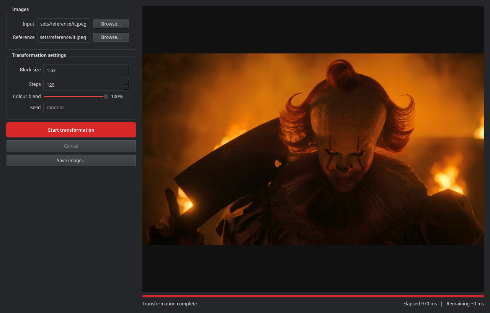
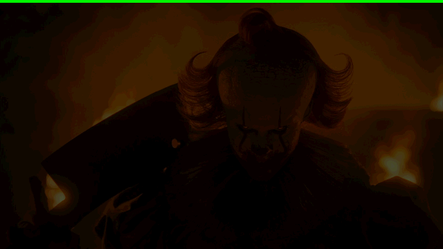

# IT Pixel Generator

[](https://github.com/golba98/IT_Pixel_Generator/actions/workflows/ci.yml)

IT Pixel Generator rebuilds any image as a mosaic of blocks sampled from a
reference image, animated as the transformation happens. It ships as a native
desktop application with a live preview and a command line tool that exports
the whole transformation as an animated GIF.

The engine is written from scratch in modern C++23 — no Python runtime is
involved — and is a complete rewrite of the original Python implementation,
preserving its visual behaviour while being roughly **12x faster** end to
end.



The animation below was produced by the CLI with the bundled reference
image (blend 1.0, block size 2):



## Features

- Native C++23 engine — fast, deterministic (seedable), and dependency-light
- Desktop GUI (Qt 6 Widgets) with live transformation preview, progress,
  elapsed time, and estimated remaining time
- Responsive UI and instant cancellation: the engine runs on a worker
  thread, never on the GUI thread
- Custom reference images, adjustable block size, animation steps, and
  colour blend
- Save results as PNG or JPEG
- Animated GIF export via the CLI, verified with real decoders
- Runs on Linux and Windows

## Requirements

- CMake 3.25+
- A C++23 compiler: GCC 12+, Clang 16+, or MSVC 2022
- Qt 6.2+ (`qt6-base` — `QtGui` and `QtWidgets`)

giflib (GIF encoding) and doctest (testing) are vendored in
`third_party/` — nothing else to install.

## Build

Fedora Linux:

```bash
sudo dnf install cmake ninja-build gcc-c++ qt6-qtbase-devel
cmake -S . -B build -G Ninja -DCMAKE_BUILD_TYPE=Release
cmake --build build --parallel
ctest --test-dir build --output-on-failure
```

Windows (MSVC): install Qt 6 for your MSVC version, then:

```powershell
cmake -S . -B build -G Ninja -DCMAKE_BUILD_TYPE=Release -DCMAKE_PREFIX_PATH=C:\Qt\6.8.3\msvc2022_64
cmake --build build --parallel
ctest --test-dir build --output-on-failure
```

Detailed platform notes, build options, and troubleshooting are in
[docs/BUILDING.md](docs/BUILDING.md).

## Running

Desktop GUI:

```bash
build/src/gui/it-pixel-gui
```

Command line — generate an animated GIF of a full transformation:

```bash
build/it-pixel-cli path/to/input.png
```

Useful options (see `it-pixel-cli --help` for all of them):

```bash
build/it-pixel-cli input.png \
    --output "my transformation.gif" \
    --reference assets/reference/it.jpeg \
    --block-size 2 --steps 60 --blend 1.0 \
    --fps 15 --frame-sample 2 --seed 42
```

| Option | Meaning |
|---|---|
| `--output` | Output GIF path (default: `it_pixels_transform.gif` next to the input) |
| `--reference` | Reference image (default: bundled `it.jpeg`) |
| `--block-size` | Mosaic block edge in pixels (default 1) |
| `--steps` | Animation batches (default 120) |
| `--blend` | How strongly blocks take the reference colour; `1.0` = flat reference colours, lower values keep the sampled image content (default 1.0) |
| `--fps` | GIF playback rate (default 25) |
| `--frame-sample` | Keep every Nth animation frame to shrink large outputs |
| `--seed` | Fix the random jitter for reproducible results |

Exit codes: `0` success, `1` processing error, `2` usage error.

## How it works

1. The input image is cut into `block_size` tiles; each tile's average
   colour and luminance are recorded.
2. The reference image is resized to the input size and cut into the same
   grid; each block's colour, luminance, and hue are recorded, and blocks
   are sorted by hue — this produces the animation's colour-sweep order.
3. Blocks are revealed in batches: for each one, the tile whose luminance
   best matches the target is selected (with a little seeded random
   jitter), optionally blended toward the target colour, and painted onto
   the canvas. Each batch is highlighted with a shimmer effect.
4. The CLI streams every frame into a GIF with an adaptive 256-colour
   palette per frame; the GUI shows the frames live and lets you save the
   final result.

For the full picture see [docs/ARCHITECTURE.md](docs/ARCHITECTURE.md).

## Project structure

```text
.
├── assets/reference/     bundled default reference image
├── include/itpixel/      public core headers
├── src/core/             mosaic engine, GIF exporter, path helpers
├── src/cli/              it-pixel-cli
├── src/gui/              it-pixel-gui (widgets, worker thread, theme)
├── tests/                doctest suite + headless GUI smoke test
├── third_party/          vendored giflib and doctest (MIT)
├── docs/                 developer documentation
└── cmake/                shared CMake helpers
```

## Development

Build, test, format, and run clang-tidy — see
[docs/DEVELOPMENT.md](docs/DEVELOPMENT.md). Pull requests should keep the
test suite and static analysis clean; CI builds GCC/Linux and MSVC/Windows
configurations on every push.

## Performance

Measured on one Linux development machine (full pipeline: engine + animated
GIF export, 120 steps, 25 fps, frame-sample 1), best of repeated runs:

| Workload | Original Python | This rewrite |
|---|---|---|
| 1280x720, block size 1 | 26.2 s | 2.2 s (~12x) |
| 640x360, block size 2 | 3.4 s | 0.26 s (~13x) |

Your numbers will vary; the CLI prints the exact parameters it used.

## License

MIT — see [LICENSE](LICENSE). giflib and doctest (vendored in
`third_party/`) are MIT as well. Qt is available under LGPL/GPLv3 (or
commercial) terms from The Qt Company; when you distribute binaries built
with the open-source Qt, its licenses apply to Qt's parts.

**About the bundled reference image:** `assets/reference/it.jpeg` predates
this rewrite. It appears to be a promotional still related to the film
referenced by the project name, and its redistribution rights have not been
verified. Replace it with an image you have the rights to if you plan to
redistribute this repository's assets.
